# 서울 불쾌상쾌 AI 비서

## 서비스 소개

일반 챗봇에게 "요즘 여름이 더 습해졌어?"라고 물으면 일반론만 돌아온다.
이 서비스는 기상청 서울 관측소의 **1961년 이후 월별 불쾌지수 788개월**을 Firestore에 저장하고,
그 요약을 AI의 시스템 프롬프트에 주입해 **내 데이터에 근거한 답변**을 준다.

- **데이터 기반 AI 채팅** — 질문하면 현재 DB 요약과 분석 결론을 근거로 답한다
- **데이터 관리** — 월별 불쾌지수 추가·수정·삭제, 변경 즉시 요약 갱신
- **대화 기록** — 대화 자동 저장, 목록 조회, 불러오기, 삭제

데이터와 분석 결론은 M1-1 분석 저장소 [summer-seoul-data](https://github.com/codysseus42/summer-seoul-data)에서 가져왔다.

## 배포 URL

| 구분 | URL |
|---|---|
| 프론트엔드 (Vercel) | https://codyssey-m-1-2-frontend.vercel.app |
| 백엔드 API (Render) | https://summer-seoul-chat-api.onrender.com |
| Swagger UI | https://summer-seoul-chat-api.onrender.com/docs |

> Render 무료 티어는 15분간 요청이 없으면 잠든다. 첫 요청이 30초~1분 걸릴 수 있다. 요청이 5초를 넘기면 화면에 안내 문구가 뜬다(콜드스타트와 긴 AI 응답을 구분할 수 없어, 두 경우 모두에 맞는 문구를 쓴다).

## 평가 기준 대응

명세의 각 항목이 어디에 구현·설명되어 있는지 정리했다. 배포된 사이트에서 직접 확인하는 시나리오는 [기능 테스트 케이스](./docs/TEST_CASES.md)에 있다.

### 최종 결과물

| 평가 항목 | 대응 코드 | 해당 절 |
| --- | --- | --- |
| 데이터 기반 AI 채팅 (요약 반영 답변 + 로딩 표시) | [service.py](./backend/service.py), [app.js](./frontend/app.js) | [컨텍스트 주입 흐름](#컨텍스트-주입-흐름-post-apichat), [채팅 화면](#데이터-요약이-보이는-채팅-질문--답변) |
| 데이터 관리 CRUD `(date, value, memo)` | [routers/data.py](./backend/routers/data.py) | [API](#api), [데이터 관리 화면](#데이터-관리-수정-결과) |
| 대화 기록 저장·목록·불러오기 | [routers/conversations.py](./backend/routers/conversations.py) | [API](#api), [대화 기록 화면](#대화-기록-불러오기) |
| 배포 및 문서화 (프론트·백엔드·Swagger·README) | 이 README | [배포 URL](#배포-url), [배포](#배포) |

### 기능 요구 사항

| 평가 항목 | 대응 코드 | 해당 절 |
| --- | --- | --- |
| 1. 개발 환경 (Python 3.10+, venv, 필수 패키지) | [requirements.txt](./backend/requirements.txt) | [로컬 실행](#로컬-실행) |
| 2. 시계열 데이터 100개 이상 + 요약 정보 | [seoul_di_monthly.csv](./backend/data/seoul_di_monthly.csv), [service.py](./backend/service.py) `compute_summary` | [데이터](#데이터), [컨텍스트 주입 흐름](#컨텍스트-주입-흐름-post-apichat) |
| 3. FastAPI 구성 · CORS · Swagger | [main.py](./backend/main.py) | [구조](#구조), [배포 URL](#배포-url) |
| 4. Firestore 연동 · 키는 환경 변수 · `data`/`conversations` 컬렉션 | [store.py](./backend/store.py) | [데이터](#데이터), [환경 변수](#환경-변수) |
| 5. 데이터 API 5개 (CRUD 4 + summary) | [routers/data.py](./backend/routers/data.py) | [API](#api) |
| 6. 대화 기록 API + 불러오기 (A안: `GET /api/conversations/{id}`) | [routers/conversations.py](./backend/routers/conversations.py) | [API](#api) |
| 7. AI 챗봇 API (요약 → 시스템 프롬프트 → GPT → 자동 저장) | [routers/chat.py](./backend/routers/chat.py), [service.py](./backend/service.py) | [컨텍스트 주입 흐름](#컨텍스트-주입-흐름-post-apichat) |
| 8. Render 배포 · Swagger · 콜드스타트 안내 | [render.yaml](./render.yaml), [app.js](./frontend/app.js) | [배포](#배포), [배포 URL](#배포-url) |
| 9. 바닐라 프론트 (채팅·데이터 관리·대화 기록·요약) | [frontend/](./frontend/) | [화면](#화면) |
| 10. Vercel 배포 · `API_BASE_URL` 환경 변수 · README | [vercel.json](./frontend/vercel.json), [build.mjs](./frontend/build.mjs) | [배포](#배포), [환경 변수](#환경-변수) |

### 제약 사항

| 평가 항목 | 대응 코드 | 해당 절 |
| --- | --- | --- |
| 백엔드 Render · 프론트엔드 Vercel 배포 | [render.yaml](./render.yaml), [vercel.json](./frontend/vercel.json) | [배포](#배포) |
| API 키·서비스 계정 키는 환경 변수, 코드에 노출 금지 | [.env.example](./backend/.env.example), [.gitignore](./.gitignore) | [환경 변수](#환경-변수) |
| 입력 검증과 예외 처리 | [models.py](./backend/models.py), [errors.py](./backend/errors.py) | [구조](#구조), [데이터](#데이터) |
| 토큰 제한 | [service.py](./backend/service.py) `OPENAI_MAX_COMPLETION_TOKENS` | [환경 변수](#환경-변수) |

### 과제 목표 (설명할 수 있어야 하는 것)

| 항목 | 해당 절 |
| --- | --- |
| 시계열 분석 → 요약 정보 → 서비스 활용 흐름 | [데이터](#데이터), [컨텍스트 주입 흐름](#컨텍스트-주입-흐름-post-apichat) |
| 라우터/서비스 분리 기준 | [구조](#구조) |
| Pydantic 요청 검증의 이유와 방식 | [구조](#구조), [데이터](#데이터) |
| Firestore 저장과 CRUD | [데이터](#데이터), [API](#api) |
| 컨텍스트 주입의 원리 | [컨텍스트 주입 흐름](#컨텍스트-주입-흐름-post-apichat) |
| 배포 환경에서 CORS·환경 변수·키 관리가 필요한 이유 | [환경 변수](#환경-변수), [배포](#배포) |

## 기술 스택

| 구분 | 사용 |
|---|---|
| 백엔드 | Python 3.11, FastAPI, Pydantic, Uvicorn |
| DB | Firebase Firestore (`firebase-admin`) |
| AI | OpenAI Python SDK, `gpt-5.5` (Codyssey copa 프록시 경유) |
| 프론트엔드 | HTML / CSS / JavaScript (프레임워크 없음) |
| 배포 | Render (백엔드), Vercel (프론트엔드) |

## 구조

```
codyssey-m-1-2/
├── backend/
│   ├── main.py            앱 조립: CORS · 예외 처리 · 라우터 등록
│   ├── routers/           APIRouter — data.py · chat.py · conversations.py
│   ├── deps.py            의존성 공급 (store · AI 클라이언트 · ChatService)
│   ├── models.py          Pydantic 요청/응답 모델 (입력 검증)
│   ├── errors.py          오류 정의 (404 · 409 · 502 · 503)
│   ├── store.py           Firestore 저장소
│   ├── service.py         요약 계산 · 컨텍스트 주입 채팅
│   ├── seed.py            시드 데이터 → Firestore
│   ├── data/seoul_di_monthly.csv
│   └── tests/test_api.py  Firebase·OpenAI 없이 API 흐름 검증
├── frontend/
│   ├── index.html  styles.css  app.js
│   ├── config.js          로컬용 API 주소
│   └── build.mjs          Vercel 빌드 시 API_BASE_URL로 config.js 생성
├── scripts/make_seed_data.py   M1-1 정제 자료 → 시드 CSV
└── render.yaml
```

분리 기준: **라우트(routers)는 HTTP만, 검증(models)은 Pydantic만, 저장(store)은 Firestore만, 로직(service)은 계산과 흐름만** 안다.
라우트는 store·service를 직접 만들지 않고 `Depends`로 `deps.py`에서 받는다.
그래서 테스트에서는 `dependency_overrides`로 store와 AI 클라이언트만 가짜로 바꿔 끼워 전체 흐름을 검증한다.

## 데이터

- 출처: 기상청 기상자료개방포털 종관기상관측(ASOS) 일자료, 서울(108)
- 가공: M1-1의 정제 자료(`asos_clean.csv`)에서 **일별 불쾌지수를 먼저 계산한 뒤 월평균** (식이 비선형이라 순서가 중요)
- 불쾌지수 = 0.81T + 0.01·RH·(0.99T − 14.3) + 46.3 (T: 평균기온 °C, RH: 평균 상대습도 %)
- 기간: 1961-01 ~ 2026-08, 788건. 유효 관측일 25일 미만인 달(수집 시점의 2026-09)은 제외
- 형태: `(date, value, memo)` — memo에는 그 달의 평균기온·평균습도·유효일수를 기록

Firestore 컬렉션:

| 컬렉션 | 문서 ID | 필드 |
|---|---|---|
| `data` | 날짜 (`1961-01-01`) | `date`, `value`, `memo` |
| `conversations` | 자동 ID | `title`, `created_at`, `updated_at`, `message_count`, `messages[]` |

`data`의 문서 ID를 날짜로 둬서 같은 날짜 중복 생성은 구조적으로 막히고, 409를 반환한다.

각 달을 즐겨찾기(☆, `starred`)할 수 있다. 최고·최저 달과 즐겨찾기한 달은 **메모와 함께** 시스템 프롬프트의 "주요 달" 목록에 들어가고, 같은 달이 여러 이유로 뽑히면 한 줄로 합쳐 태그를 붙인다(예: `[최고·즐겨찾기]`). `PUT`에서 `starred`를 생략하면 기존 즐겨찾기를 유지한다.

날짜는 매달 1일(`YYYY-MM-01`)만 받고, 현재 달을 포함해 6개월 뒤까지만 입력할 수 있다(그 이후는 422). 현재·미래 달은 화면에서 예측값인지 확인한 뒤 저장한다.

`data` 전체 읽기(788건)는 서버 메모리에 캐시한다. 요청마다 읽으면 Firestore 무료 한도(읽기 5만 건/일)를
새로고침 30번 남짓에 다 쓰기 때문이다. 이 API를 거친 추가·수정·삭제는 즉시 캐시를 비우고,
Firebase 콘솔 직접 수정이나 `seed.py` 재실행 같은 외부 변경은 최대 10분 뒤 반영된다(서버 재시작 시 즉시).

## API

| 메서드 | 경로 | 설명 |
|---|---|---|
| GET | `/api/data` | 데이터 목록 (날짜순) |
| POST | `/api/data` | 추가 (중복 날짜 409) |
| PUT | `/api/data/{id}` | 값·메모 수정 |
| DELETE | `/api/data/{id}` | 삭제 |
| GET | `/api/data/summary` | 요약 (프롬프트 주입용) |
| POST | `/api/chat` | AI 채팅 (자동 저장) |
| POST | `/api/conversations` | 대화 저장 |
| GET | `/api/conversations` | 대화 목록 (**messages 미포함**) |
| GET | `/api/conversations/{id}` | 대화 불러오기 (전체 messages) |
| DELETE | `/api/conversations/{id}` | 대화 삭제 |

### 컨텍스트 주입 흐름 (`POST /api/chat`)

1. (이어서 묻는 경우) 해당 대화의 최근 10개 메시지를 불러온다
2. 현재 `data` 컬렉션 전체로 요약을 계산한다 — `/api/data/summary`와 같은 함수
3. 요약 + M1-1 분석 결론을 **시스템 프롬프트**에 넣는다
4. GPT를 호출한다
5. 질문과 답변을 `conversations`에 저장한다 (AI 호출이 실패하면 저장하지 않는다)

CSV 원본은 OpenAI로 보내지 않는다. 모델이 받는 것은 약 900자의 요약 텍스트뿐이다.

요약은 오늘 날짜(한국 시간)를 기준으로 기록을 셋으로 나눈다.

| 구분 | 범위 | 쓰임 |
|---|---|---|
| 기본(관측) 기록 | 1961-01 ~ 지난달 | 기간·레코드·관측 평균·최고·최저·추세·여름 평균 |
| 예측값 | 이번 달 이후 (사용자 입력) | 추가 기록 |
| 과거 추가 | 1961-01 이전 (사용자 입력) | 추가 기록 |

기간은 1961-01부터 **마지막 관측 달**까지이고, 그 사이 빈 달을 **결측**으로 센다. 아직 자료가 없는 최근 달은 결측이 아니다. 추가 기록은 전체 개수·전체 평균·추가 포함 최고/최저에만 들어간다. 오늘 날짜와 추가 기록 정보도 시스템 프롬프트에 함께 넣는다.

예측값과 관측값은 날짜로만 나누므로, 달이 지나면 예측값으로 넣은 값이 관측 통계에 들어간다. **달이 지나면 실제 값으로 수정하는 것**을 운영 규칙으로 둔다. 불쾌지수는 음수도 가능하므로 범위를 막지 않고, 대신 AI가 그 달의 관측 범위를 크게 벗어난 값이나 메모와 어긋나는 값을 답변에서 짚도록 했다.

요약의 `trend`는 **마지막 기본 기록 달까지의 최근 12개월 평균과 직전 12개월 평균**을 비교한다(차이 0.5 이내면 '유지').
24개월 중 하나라도 빠지면 '알 수 없음'이다. 12개월 창끼리 비교하므로 여름·겨울 계절성이 상쇄된다. 장기 변화는 `summer_by_decade`(기본 기록의 여름 월평균을 10년 단위로 평균)로 따로 제공한다. 요약은 요청마다 DB에서 다시 계산하는 실시간 값이다.

## 로컬 실행

사전 준비: Firebase 서비스 계정 키, copa 가상 키.

```bash
git clone https://github.com/codysseus42/codyssey-m-1-2.git
cd codyssey-m-1-2/backend
python -m venv .venv
source .venv/bin/activate            # Windows: .venv\Scripts\activate
pip install -r requirements.txt

cp .env.example .env                 # 값 채우기
# Firebase 키 JSON을 backend/firebase-key.json 으로 저장

python seed.py                       # 788건 적재 (여러 번 실행해도 중복 없음)
# python seed.py --reset             # 원복: 시드 값으로 덮어쓰고 시드에 없는 달은 삭제
# python seed.py --all               # --reset + 대화 기록 전체 삭제
uvicorn main:app --reload            # http://localhost:8000/docs
```

다른 터미널에서 프론트엔드:

```bash
cd codyssey-m-1-2/frontend
python -m http.server 3000           # http://localhost:3000
```

테스트 (Firebase·OpenAI 없이 실행됨):

```bash
cd backend
pip install -r requirements-dev.txt
pytest -q
```

## 환경 변수

**백엔드 (Render)**

| 변수 | 예시 | 설명 |
|---|---|---|
| `OPENAI_API_KEY` | (비밀) | copa 가상 키 |
| `OPENAI_BASE_URL` | `https://copa.codyssey.kr/v1` | OpenAI 호환 엔드포인트. 비우면 OpenAI 직접 호출 |
| `OPENAI_MODEL` | `gpt-5.5` | 모델 (copa의 GPT 계열: `gpt-5.5` · `gpt-5.4` · `gpt-5.4-mini` · `gpt-5-mini`) |
| `FIREBASE_SERVICE_ACCOUNT_PATH` | `/etc/secrets/firebase-key.json` | 서비스 계정 키 파일 경로 |
| `FIREBASE_SERVICE_ACCOUNT_JSON` | (선택) | 파일 대신 JSON 문자열로 줄 때 |
| `ALLOWED_ORIGINS` | `https://xxx.vercel.app` | CORS 허용 출처 (쉼표 구분) |
| `OPENAI_MAX_COMPLETION_TOKENS` | `4000` | (선택) 응답 토큰 상한 |

**프론트엔드 (Vercel)**

| 변수 | 예시 | 설명 |
|---|---|---|
| `API_BASE_URL` | `https://xxx.onrender.com` | 백엔드 주소. 빌드 시 `config.js`로 주입 |

API 키와 서비스 계정 키는 코드와 저장소에 넣지 않는다 (`.gitignore`에 등록).

## 배포

**Firebase**
1. Firebase 콘솔에서 프로젝트 생성 → Firestore Database 만들기 (위치 `asia-northeast3`)
2. 프로젝트 설정 → 서비스 계정 → 새 비공개 키 생성 → JSON 다운로드
3. 로컬에서 `python seed.py`로 데이터 적재

**Render (백엔드)**
1. New → Blueprint → 이 저장소 선택 (`render.yaml` 사용)
2. `OPENAI_API_KEY` 입력, `ALLOWED_ORIGINS`는 일단 비워 둔다
3. 서비스 → Environment → Secret Files에 `firebase-key.json` 업로드 (내용 = 키 JSON)
4. 배포 후 `https://….onrender.com/docs` 확인

**Vercel (프론트엔드)**
1. New Project → 이 저장소 → Root Directory `frontend`
2. Environment Variables에 `API_BASE_URL` = Render 주소
3. 배포 후 Vercel 운영 도메인을 Render의 `ALLOWED_ORIGINS`에 넣고 재배포

## 화면

### 데이터 요약이 보이는 채팅 (질문 + 답변)
위쪽 요약 카드와 같은 데이터를 근거로, 수치(관찰)와 가능한 원인(해석)을 나눠 답한다.

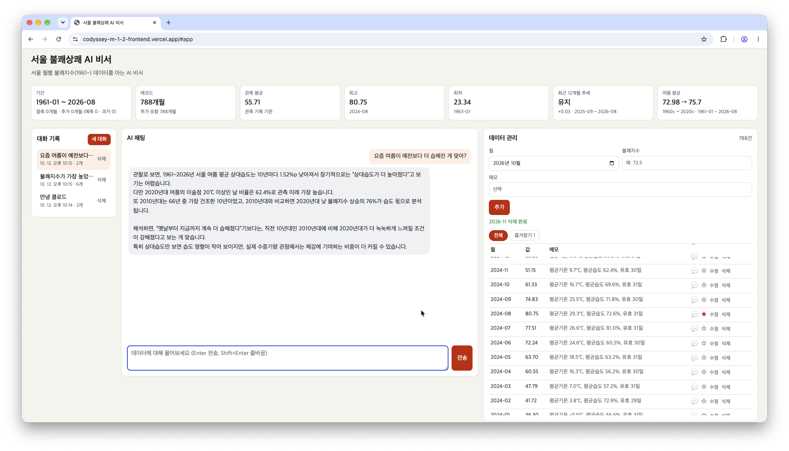

### 데이터 관리 (수정 결과)
예측값(2026-11)을 수정하면 완료 메시지와 함께 표와 요약 카드(추가 1개월)가 바로 갱신된다.

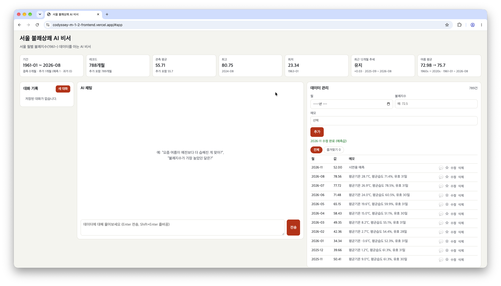

### 대화 기록 (불러오기)
왼쪽 목록에서 이전 대화를 누르면 그 대화의 메시지가 다시 표시되고, 이어서 질문하면 이전 맥락을 이어받는다.

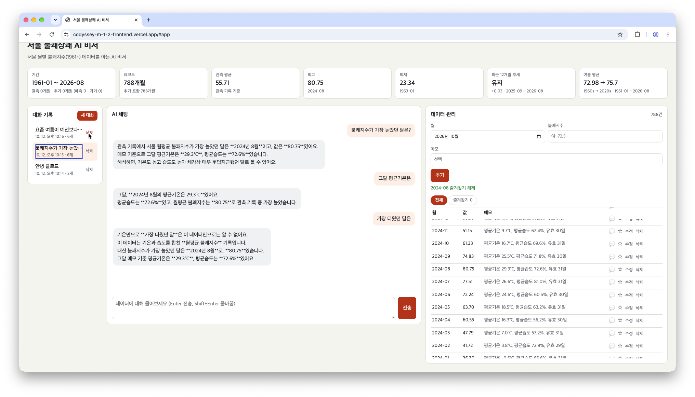

### 기능별 화면

| 화면 | 설명 |
| --- | --- |
| 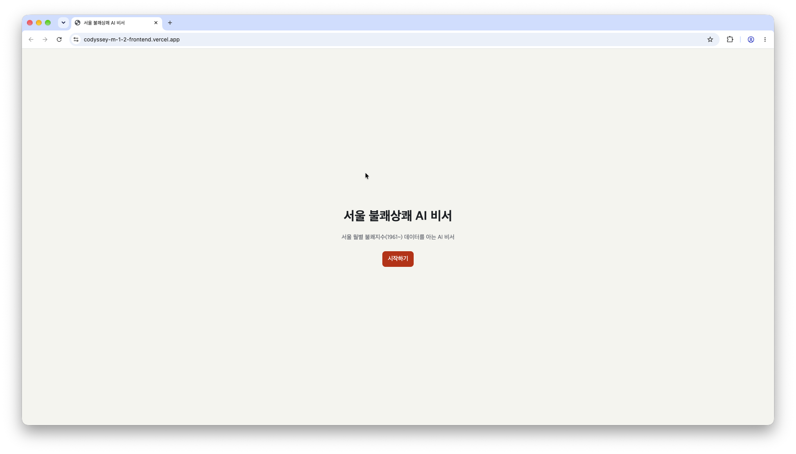 | 소개 화면 → "시작하기"로 대시보드 이동 |
| 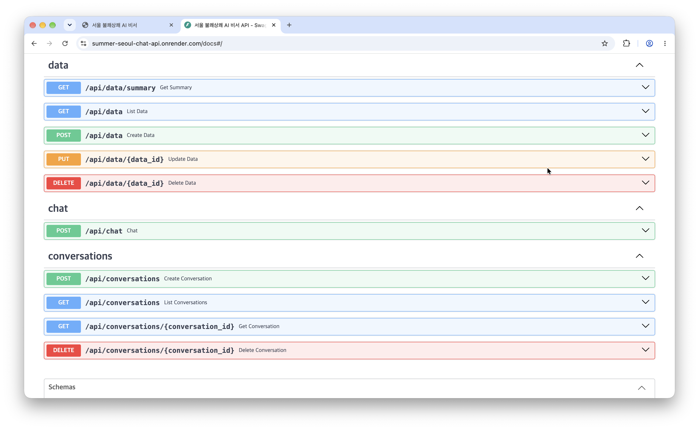 | Swagger UI: data · chat · conversations 엔드포인트 10개 |
| 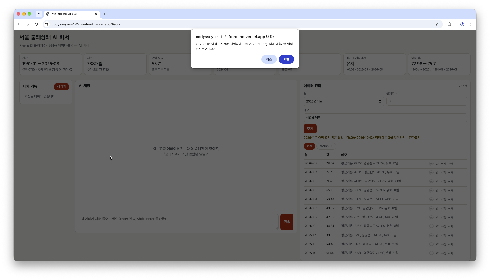 | 현재·미래 달을 입력하면 예측값인지 확인한 뒤 저장 |
| 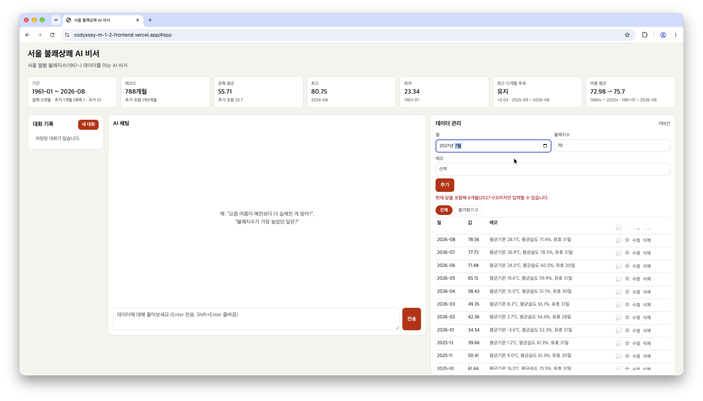 | 현재 달 포함 6개월을 넘는 달은 입력 불가 |
| 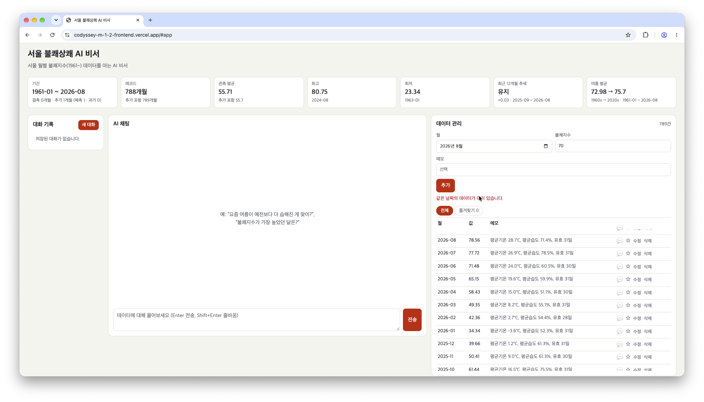 | 같은 달 중복 추가는 409 "같은 날짜의 데이터가 이미 있습니다." |
| 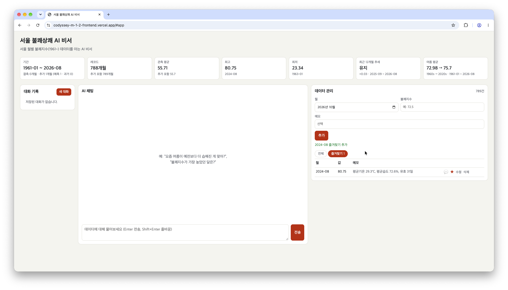 | ☆ 즐겨찾기와 즐겨찾기 탭(즐겨찾기한 달만 보기) |
| 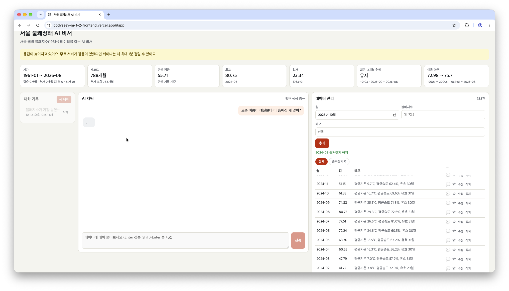 | 5초 넘는 응답에 콜드스타트 안내, 답변 대기 중에는 대화 기록 잠금 |
| 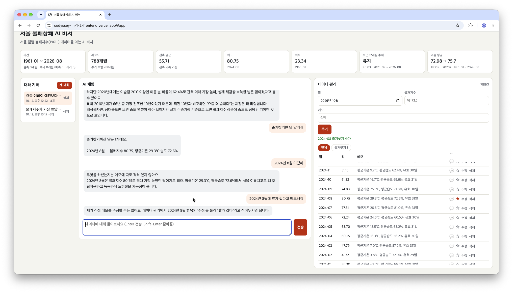 | 즐겨찾기 목록, 특정 달의 메모 읽기, 메모 작성 요청은 직접 하도록 안내 |
| 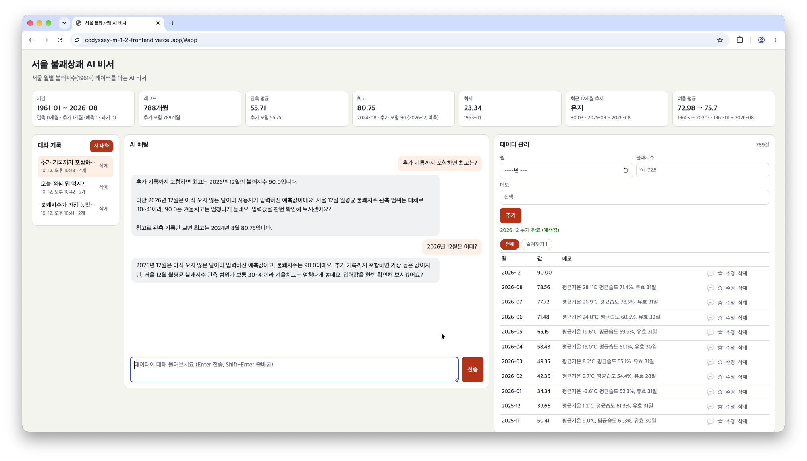 | 추가 기록 반영(추가 포함 최고 90)과 계절 범위를 벗어난 값 짚기 |
